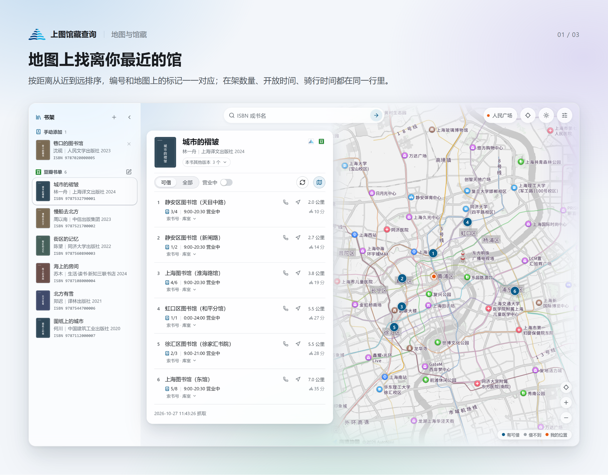
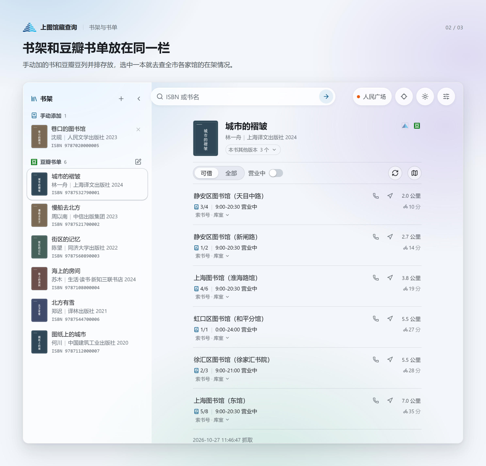

# 上图馆藏查询

> **非官方项目** · 与上海图书馆、豆瓣均无隶属或合作关系，仅供个人查询辅助使用。
> 项目里的馆藏数据来自公开页面，界面标识归各自所有者，见 [THIRD-PARTY.md](THIRD-PARTY.md)。

把豆瓣书单和手动加的书放在一起，查**上海图书馆及全市分馆的实时在架状态**，
按离你的距离从近到远排，在地图上标出来。自己用，数据只留在本机。






## 它做什么

- **书架**：导入豆瓣豆列（自动抓书名 / 作者 / 出版社 / ISBN），也能手动加书；两组分开放，
  一眼看清哪本来自豆列、哪本是自己加的。
- **查馆藏**：按 ISBN 查上图 + 全部分馆的逐册状态——在架 / 已借出、库室、索书号、借阅类型；
  同一本书的多个版本可以先选版本再查。
- **按距离排**：479 个网点（馆、服务点）带地址、电话、开放时间；离你最近的在最上面，
  10 公里内还会算一条骑行时间。
- **地图**：结果编号和地图标记一一对应，点标记看馆、点列表看图钉，滚轮无级缩放。
- **手机**：同一 Wi-Fi 下手机浏览器打开就能用，不用装 App；手机端只读，改配置还是回电脑。

## 快速开始

### 打包版（Windows，免装 Python）

1. 在仓库首页右侧打开 **Releases**，下载 `shlib-finder-v<版本>.zip`（约 12 MB，包里自带 Python）。
2. 解压到任意目录，双击 `start-server.bat`，浏览器会自动打开 <http://127.0.0.1:8765/>。
3. 用完关掉命令行窗口就是停止；想重开双击 `restart-server.bat`。

打包版只有 Windows。macOS / Linux 用下面的源码方式。

### 源码方式

需要 Python 3.9 或更高，不用装任何第三方库。

- **Windows**：双击 `start-server.bat`。
- **macOS / Linux**：

  ```bash
  git clone <本仓库地址>
  cd shlib-finder
  ./start-server.sh
  ```

源码方式下，Windows 和 macOS / Linux 都是把服务起在 8765，再自动打开浏览器；日志在 `data/server.log`。
也可以 `python3 web/server.py` 前台运行，在终端看到全部输出。
改过配置或代码要重启：`restart-server.sh` / `restart-server.bat`，或设置面板里的「重启服务」。

## 第一次打开要做什么

四件事，前三件都可以跳过：

1. **设置位置**（可选，默认人民广场）。手输的地址只认上海境内，别的城市会明确拒绝，
   不会悄悄落到别的省市同名地点。
2. **填高德 Key**（可选，不填也能查馆藏）。
3. **填豆瓣豆列地址**（可选，不填左边书架就是空的，手动加书照常）。
4. **想用手机**：设置里打开「从其他设备访问」，面板会给出局域网地址和二维码。

这几项都在设置面板里填。不想用面板也行：照 [`config.example.json`](config.example.json)
的结构写一份 `config.json` 放在根目录；不建这个文件也能跑，全部走默认值。

### 两把高德 Key，别搞混

都到 [高德开放平台](https://lbs.amap.com/) 申请，**选错类型对应的功能就是不出结果**：

| 设置里的位置 | Key 类型 | 用来做什么 | 不填的后果 |
|---|---|---|---|
| 地址与距离 | **Web 服务** | 地址转坐标、骑行时间 | 手输地址转不了坐标，没有骑行时间 |
| 地图背景 | **Web 端（JS API）** | 结果区后面那张地图 | 没有地图；2021-12 之后申请的还要再填「安全密钥」 |

- 骑行只认高德。配成腾讯 Key（[lbs.qq.com](https://lbs.qq.com/)）时只能地址转坐标，
  骑行时间不显示，也不报错。
- Key 不要提交到仓库：在设置面板里填，只写进本机的 `config.json`。

## 数据从哪来

| 内容 | 来源 |
|---|---|
| 书单（书名 / 作者 / 出版社 / ISBN） | 豆瓣豆列页面及其条目页 |
| 同书名的其他版本 + 各自 ISBN | 上图书目检索 |
| 逐册在架状态（馆 → 库室 → 每册） | 上图的馆藏页 |
| 479 个网点的名称 / 地址 / 电话 / 开放时间 | 上图公开页面内嵌的网点信息 |
| 网点经纬度 | 高德 / 腾讯地理编码（上图不提供坐标） |

[`data/libraries.json`](data/libraries.json)（479 个网点，188 KB）是仓库里唯一带成品数据的文件，
随仓库分发是为了省掉几百次地理编码请求。字段来源、坐标口径和怎么合规使用写在
[THIRD-PARTY.md](THIRD-PARTY.md) 里：名称 / 地址 / 电话 / 开放时间是公开信息，坐标是地理编码
服务的产出，本项目按**非商业用途**分发，要商用请自行换成合规数据源重算。

其余的（书单缓存、馆藏缓存、封面、坐标缓存）都只生成在这台机器上，不上传到任何地方。

抓取都在服务端做，并且做了限流：够自己查书用，不会把别人的网站打满。

## 隐私与安全

- 默认**只监听 `127.0.0.1`**，同一网段的其他设备也连不上；要开手机访问必须手动打开开关。
- 打开后**局域网设备只读**：能查书、看结果，改不了设置。
- 改配置、重启这类写操作只接受本机页面发来的请求，其他来源一律 403。
- 地图 Key 只发给本机页面，局域网设备看不到完整 Key。
- 没有账号、没有遥测、没有外部上报：所有请求都是你自己这台机器发出去的。

细节和漏洞报告方式见 [SECURITY.md](SECURITY.md)。

## 已知限制

- **一个 ISBN 只代表一个版本**，不同版次 / 译者的馆藏分布可能完全不同，先选对版本再查。
- **可借数是抓取那一刻的快照**，出门前最好给馆里打个电话。
- **接口是页面接口，不是承诺的 API**，上图改版就可能失效；馆藏有 12 小时缓存，
  结果区会标出数据时间。
- **节假日只做提醒、不做硬判断**，实际开馆时间以各馆公告为准。
- **坐标不保证逐条准确**：429/479 个网点有坐标，其余显示「距离未知」。

## 许可

[PolyForm Noncommercial License 1.0.0](LICENSE)：允许**非商业用途**的使用、修改和再分发
（个人学习、研究、业余项目、慈善 / 教育机构等），**禁止任何商业用途**。

需要说明的是：它不是 OSI 认可的开源许可，严格说是「源码可得的非商业许可」（source-available），
GitHub 等平台不会给它打「Open Source」标签。要商用请先联系作者取得授权。

第三方组件与标识的许可见 [THIRD-PARTY.md](THIRD-PARTY.md)。

想读代码或改代码：页面在 `web/app.js`，与服务端共用的纯逻辑在 `web/shlib.js`，服务端在
`web/server.py`；回归测试在 `tests/`，跑法是 `node tests/shlib.test.js` 和
`python -m unittest discover -s tests`（都不需要装第三方库）。
